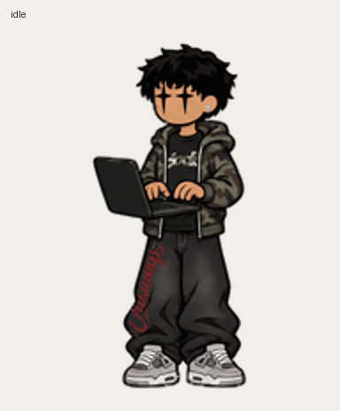

# The Best Pet in Codex · Camo

Así construimos **Camo**, una mascota personal de estética urbana para ChatGPT Work y Codex: chaqueta camuflada abierta, camiseta negra, pantalón ancho, zapatillas grises, pelo negro y un arete brillante. Su pose principal es de pie, tecleando en un portátil negro flotante.



[Ver el video de revisión](assets/previews/todos-los-estados.mp4) · [Guía para crear tu personaje](docs/CREAR_UN_PERSONAJE.md) · [Instrucciones para agentes](AGENTS.md)

## Estados del personaje

La hoja final v2 tiene **73 fotogramas**, distribuidos en once filas. Las nueve primeras contienen animaciones y las dos últimas contienen poses de mirada.

| Fila | Estado | Fotogramas | Comportamiento |
| --- | --- | ---: | --- |
| 0 | `idle` | 6 | Teclea en el portátil flotante; es el reposo personalizado. |
| 1 | `running-right` | 8 | Corre hacia la derecha durante el arrastre horizontal. |
| 2 | `running-left` | 8 | Corre hacia la izquierda durante el arrastre horizontal. |
| 3 | `waving` | 4 | Levanta una mano para saludar. |
| 4 | `jumping` | 5 | Se prepara, salta y aterriza en la misma base. |
| 5 | `failed` | 8 | Baja ligeramente la cabeza y los hombros ante un error. |
| 6 | `waiting` | 6 | Hace un gesto expectante con la palma abierta para pedir intervención. |
| 7 | `running` | 6 | Trabaja activamente tecleando. Este nombre representa trabajo, no una carrera. |
| 8 | `review` | 6 | Revisa el resultado en la pantalla del portátil. |
| 9–10 | Miradas | 16 | Gira e inclina la cabeza siguiendo dieciséis direcciones. |

El reproductor de la aplicación decide cuándo activar cada estado y a qué velocidad reproducirlo. Los GIF sirven para revisar el dibujo; su ritmo puede diferir del de la aplicación.

## Usar Camo en el escritorio

1. Clona este repositorio y entra en su carpeta.
2. En PowerShell ejecuta `./scripts/install-local.ps1`.
3. Abre **Ajustes → Mascotas → Actualizar → Camo** en la aplicación compatible.

El instalador copia únicamente `pets/camo/pet.json` y `pets/camo/spritesheet.png` a `%USERPROFILE%/.codex/pets/camo`. Si utilizas un directorio de Codex diferente, pasa `-CodexHome 'D:/mi-codex'`. Comprueba la integridad antes de copiar y evita reemplazar una mascota distinta que ya ocupe esa carpeta.

La copia local no registra automáticamente una mascota en ChatGPT Work. Para ese destino, usa el plugin **Pets** con el flujo de validación, creación y selección descrito en la guía. El ID de una mascota pertenece a la cuenta que la creó: este repositorio no distribuye el ID personal ni enlaces temporales de descarga.

## Formato y validación

- PNG con transparencia, **1536 × 2288 px**, ocho columnas y once filas.
- Celdas de **192 × 208 px**; quince celdas sin uso completamente transparentes.
- Integridad y procedencia del archivo en [release.json](pets/camo/release.json).
- Revisión original: scripts de la skill `work-pets:create-pet`, tres revisiones independientes de orientación y preflight de Pets aprobado. El salto despega 13 px y regresa a la misma base.

Para comprobar la distribución descargada:

```sh
python -m pip install -r requirements.txt
python scripts/verify_release.py
```

Esta comprobación verifica el paquete publicado. Para modificar el dibujo hay que repetir la revisión visual y el flujo completo de la skill; el hash por sí solo no evalúa la calidad de una animación.

## Estructura

```text
assets/                 Referencia aprobada y vistas previas finales
docs/                   Proceso de creación y decisiones de compatibilidad
pets/camo/              Manifiesto, hoja lista para instalar y datos de integridad
scripts/                Instalación local y comprobación de la distribución
README.md               Presentación e instrucciones para personas
AGENTS.md               Contexto y reglas para agentes que trabajen aquí
```

## Límites y decisiones

La implementación se preparó para el formato v2 compatible con la versión de Codex inspeccionada en noviembre de 2026. La aplicación puede cambiar: verifica su compatibilidad al instalar en otra versión. [Documentación oficial de mascotas](https://learn.chatgpt.com/docs/pets).

Se diseñó además un prototipo suspendido por la capucha al mantener pulsado sin mover. **Ese gesto no quedó integrado en la mascota nativa**, porque la versión inspeccionada no expone un estado independiente para él. La pose acostada con tres Z quedó como idea futura y no forma parte de esta distribución. Tampoco hay alternancia aleatoria de reposos implementada.
